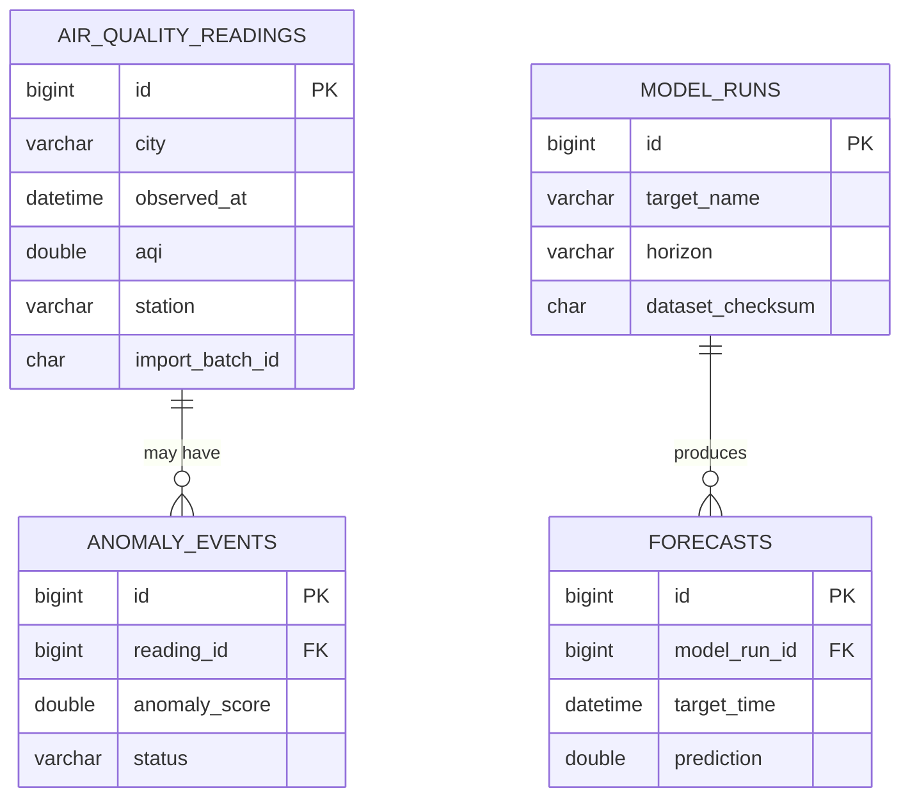

# Database design (Phase 4 proposal)

## Current status

This is a proposal based on the observed clean CSV. The local MySQL service
(`MySQL80`) is running and `127.0.0.1:3306` is reachable. No database or table
has been created yet because credentials and the existing database inventory
have not been verified.

The proposed database name is `air_quality_db`. Before creating or reusing it,
inspect whether it already exists and obtain approval for the exact action.

## Observed data facts

- Clean rows: 382,343
- Columns: 18
- Date range from `Datetime`: 2015-01-01 through 2024-12-31
- Cities: Delhi, Mumbai, Chennai, Kolkata, Bangalore
- Non-null station values: 43,740 across 10 station identifiers
- Rows with null `Datetime`: 2,402
- Rows with null `Station`: 338,603
- Rows with null `Date`: 379,941
- Rows rejected during cleaning: 0

The nullable timestamp, date, and station fields are intentional. They must not
be silently replaced or used as a unique key until the data policy is approved.

## Tables

### `air_quality_readings`

Stores validated source observations and retains source-row and import-batch
traceability. Pollutant values are nullable because the source contains
missing measurements. `observed_at` maps from `Datetime`; `source_date` maps
from `Date`.

No natural unique key is declared yet. The source contains many missing
timestamps/stations, so repeat-safe import requires an approved staging or
batch strategy.

### `model_runs`

Stores model target, horizon, dataset checksum, chronological split boundaries,
parameters, and measured metrics.

### `forecasts`

Stores predictions separately from observed readings, including model run,
target time, horizon, and generation time.

### `anomaly_events`

Stores potential anomaly scores and interpretation status. These records must
not be described as confirmed pollution events.

## ER diagram

Schema SQL is in
[001_initial_schema.sql](../database/schema/001_initial_schema.sql). It uses
`CREATE TABLE IF NOT EXISTS` and does not drop or truncate existing objects.
